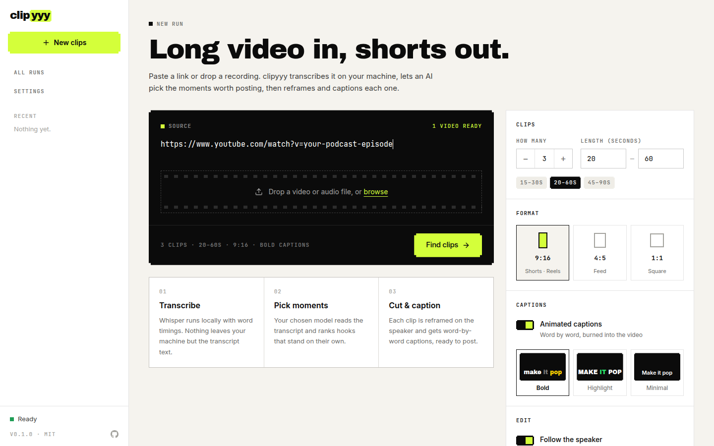

<div align="center">

# clipyyy

**Free, open-source AI video clipper. Turn long videos and podcasts into viral short clips for TikTok, Instagram Reels and YouTube Shorts.**

An open-source, self-hosted alternative to OpusClip, Vizard and Klap. Runs on your machine, works with any AI model, and adds no watermark.

[](LICENSE)
[](pyproject.toml)
[](https://github.com/T3-Venture-Labs-Limited/clipyyy/actions/workflows/ci.yml)
[](#quick-start)

[Quick start](#quick-start) · [Features](#features) · [CLI and AI agents](#cli-and-ai-agents) · [How it works](#how-it-works) · [FAQ](#faq)



</div>

## What is clipyyy?

clipyyy is an open-source tool that cuts long-form video into short vertical clips automatically. Give it a YouTube link, a podcast episode, an interview or a talk. It transcribes the audio locally with Whisper, asks a large language model to find the moments that work on their own, reframes each one around the speaker for 9:16, and burns in animated word-by-word captions. You get ready-to-post MP4 files with a title, caption and hashtags for each clip.

It has a web app for people and a JSON command line for scripts and AI coding agents. Your videos never leave your computer; only the transcript text is sent to the model you choose.

## Features

- **AI clip finder.** An LLM reads the whole transcript and ranks the strongest standalone moments by hook, value and clarity. Clips are snapped to sentence boundaries so nothing starts or ends mid-thought.
- **Bring your own model.** Works with any model on [OpenRouter](https://openrouter.ai): Gemini, Claude, GPT, DeepSeek, Qwen, Llama and more. A one-hour video costs about one cent with a fast model.
- **Local transcription.** [faster-whisper](https://github.com/SYSTRAN/faster-whisper) with word-level timestamps, on CPU or GPU, in 90+ languages.
- **Automatic reframing.** Face tracking (MediaPipe) keeps the speaker centred when converting horizontal video to 9:16, 4:5 or 1:1.
- **Animated captions.** Word-by-word highlighted subtitles in three styles, rendered with ffmpeg.
- **Post-ready copy.** Every clip comes with a YouTube Shorts title, a social caption and hashtags.
- **Any source.** YouTube and the 1,000+ sites [yt-dlp](https://github.com/yt-dlp/yt-dlp) supports, or upload a local video file.
- **Batch processing.** Paste many links at once; runs are queued and resume where they stopped if something fails.
- **Optional B-roll.** Cuts in matching free stock footage from Pexels.
- **Optional auto-posting.** Publish or schedule clips to TikTok, Instagram, YouTube, Facebook and more through [Buffer](https://buffer.com).
- **No watermark, no credits, no limits.** MIT licensed.

## Quick start

### Docker (easiest)

```bash
git clone https://github.com/T3-Venture-Labs-Limited/clipyyy
cd clipyyy
docker compose up -d
```

Open http://localhost:8000, paste your [OpenRouter API key](https://openrouter.ai/keys) when asked, paste a video link and click **Find clips**. Clips, runs and settings are saved in `./data`.

### From source

Requires Python 3.11 or 3.12, Node 22+, [uv](https://docs.astral.sh/uv/), ffmpeg with libass (Linux distribution packages include it; on a Mac see [below](#macos)), and deno or node for YouTube downloads.

```bash
git clone https://github.com/T3-Venture-Labs-Limited/clipyyy
cd clipyyy
uv sync
npm --prefix frontend ci && npm --prefix frontend run build
uv run clipyyy serve
```

Open http://127.0.0.1:8000. Run `uv run clipyyy doctor` to check your setup.

### macOS

clipyyy runs on Apple Silicon Macs with macOS 14 (Sonoma) or newer, and on Intel Macs with macOS 13 (Ventura) or newer. Install the tools with [Homebrew](https://brew.sh), then follow the steps above:

```bash
brew install ffmpeg-full uv node deno
```

- **Use `ffmpeg-full`, not `ffmpeg`.** Homebrew's standard `ffmpeg` is built without libass, so it can't draw captions. `ffmpeg-full` can. Homebrew doesn't put it on your PATH, but clipyyy finds it automatically. `uv run clipyyy doctor` shows which ffmpeg is used, and `CLIPYYY_FFMPEG` points it at another one.
- **Transcription** runs on the processor, not the Mac's GPU. A smaller Whisper model under Settings is faster.
- **Docker** works too, with Docker Desktop on both Apple Silicon and Intel.

## CLI and AI agents

Everything in the web app is also available from the command line. Every command accepts `--json`, so scripts and coding agents (Claude Code, Codex, Cursor and others) can use clipyyy directly.

```bash
clipyyy config set openrouter_api_key sk-or-...

# Find the 5 best clips under 45 seconds and save them to ./shorts
clipyyy clip "https://www.youtube.com/watch?v=..." --count 5 --max 45 --out ./shorts

# A local podcast recording, square format, with B-roll and extra guidance
clipyyy clip ~/podcast/episode-12.mp4 --aspect 1:1 --broll --instructions "Only the funniest moments"

clipyyy runs                            # list runs
clipyyy show <run-id> --json            # clips with captions, hashtags and file paths
clipyyy retry <run-id> --from select    # pick new clips without re-transcribing
clipyyy models gemini                   # search available models
clipyyy publish <clip-id> --channel <buffer-channel-id> --mode queue
```

Example `--json` output:

```json
{
  "run_id": "3f9c2a1b7d40",
  "status": "completed",
  "clips": [
    {
      "rank": 1,
      "title": "Why most startups price too low",
      "post_title": "The Pricing Mistake That Kills Startups",
      "caption": "Charging more filtered out the customers who were never going to stay.",
      "hashtags": ["#startups", "#pricing", "#founders"],
      "duration_seconds": 48.2,
      "score": 9.1,
      "file": "/home/you/shorts/clip-01-why-most-startups-price-too-low.mp4"
    }
  ]
}
```

For agents, [`skills/clipyyy/SKILL.md`](skills/clipyyy/SKILL.md) is a ready-made skill file, and [`AGENTS.md`](AGENTS.md) explains the codebase.

## How it works

| Step | What happens |
|---|---|
| 1. Download | yt-dlp fetches the video (up to 1080p), or a local file is used. |
| 2. Transcribe | faster-whisper produces word-level timestamps on your machine. |
| 3. Find clips | The LLM returns ranked clips with titles, captions, hashtags and B-roll ideas. Clips are checked against your length limits. |
| 4. Plan edits | Each clip is split into short shots; some are marked for B-roll. |
| 5. B-roll | Matching stock footage is downloaded from Pexels (optional). |
| 6. Reframe | Faces are tracked and the crop follows the main speaker. |
| 7. Render | ffmpeg cuts the clip, keeps the original audio and burns in captions. |

Every step saves its result, so a failed run resumes from the step that failed.

## clipyyy vs OpusClip, Vizard and Klap

| | clipyyy | Hosted clipping tools |
|---|---|---|
| Price | Free and open source (MIT); you pay only for model usage, about $0.01 per hour of video | Monthly subscriptions or credits |
| Watermark | Never | Some free plans add one |
| Where videos are processed | On your computer | Uploaded to the vendor's servers |
| AI model | Any model on OpenRouter | Fixed by the vendor |
| Automation | JSON CLI and agent skill | Web app, some offer an API |
| Customisation | Edit the prompt, caption styles and code | Settings in their UI |

Hosted tools are more polished and need no setup. clipyyy is for people who want control, privacy, no limits, or to automate clipping with scripts and agents.

## Settings

Add keys in the web app under **Settings**, with `clipyyy config set <key> <value>`, or with environment variables. Values saved in the app take priority.

| Setting | Environment variable | Used for |
|---|---|---|
| `openrouter_api_key` | `OPENROUTER_API_KEY` | Finding clips (required) |
| `llm_model` | `CLIPYYY_LLM_MODEL` | Default model, `google/gemini-3.8-flash` |
| `whisper_model` | `CLIPYYY_WHISPER_MODEL` | `tiny`, `base`, `small` (default), `medium`, `large-v3`, `turbo` |
| `ytdlp_cookies_from_browser` | `CLIPYYY_COOKIES_FROM_BROWSER` | Using your browser's YouTube login if YouTube blocks downloads |
| `pexels_api_key` | `PEXELS_API_KEY` | B-roll |
| `buffer_api_key` | `BUFFER_API_KEY` | Auto-posting |
| `s3_*` | `CLIPYYY_S3_*` | Hosting clips so Buffer can fetch them |
| `default_instructions` | `CLIPYYY_DEFAULT_INSTRUCTIONS` | Guidance added to every run, such as your audience or a call to action |

Data is stored in `CLIPYYY_HOME` (default `~/.clipyyy`).

### Auto-posting with Buffer

Buffer accepts media only by public URL, so clipyyy first uploads the clip to your own S3-compatible bucket (Cloudflare R2, Backblaze B2, AWS S3 or MinIO), then creates the post as queued, scheduled, immediate or draft. Add your [Buffer API key](https://publish.buffer.com/settings/api) and bucket details under Settings.

## FAQ

**Is clipyyy free?**
Yes. clipyyy is free and open source under the MIT licence. The only cost is the AI model you choose through OpenRouter, typically about one cent for an hour-long video with a fast model.

**What is the best free OpusClip alternative?**
clipyyy is a free, open-source OpusClip alternative that runs locally, has no watermark or credit limits, works with any AI model, and includes both a web app and a CLI.

**Can it clip podcasts?**
Yes, video podcasts. Upload the recording or paste a YouTube or other link. Audio-only files are not supported yet because clips need a picture.

**Does it work on a Mac?**
Yes: Apple Silicon with macOS 14 or newer, and Intel with macOS 13 or newer. Install `ffmpeg-full` from Homebrew rather than `ffmpeg`; see [macOS](#macos).

**Does it need a GPU?**
No. Transcription runs on the CPU; an hour of video takes several minutes. A CUDA GPU makes it faster and is used automatically when available.

**Which languages are supported?**
Whisper transcribes 90+ languages and detects the language automatically. Titles and captions are written in the language of the video unless you ask otherwise.

**Which AI model should I use?**
Fast, cheap models with long context work well, such as Gemini Flash or DeepSeek. Any model on OpenRouter that supports structured output can be used.

**YouTube says "Sign in to confirm you're not a bot". What do I do?**
Wait and retry, or choose your browser under Settings → Downloads so yt-dlp can use your YouTube login.

**Can AI agents use it?**
Yes. Every CLI command returns JSON, and `skills/clipyyy/SKILL.md` teaches agents how to use it.

## Privacy and security

- Videos stay on your machine. The model provider receives the transcript text and video title.
- API keys are stored in the local SQLite database. Protect the data folder.
- The web app has no login and listens on localhost by default. Do not expose it to the internet without authentication in front of it.

## Development

```bash
uv sync
uv run pytest -q                  # tests (need ffmpeg)
uv run ruff check src tests
npm --prefix frontend run dev     # UI on :5173, proxies /api to :8000
uv run clipyyy serve              # API and worker on :8000
```

Contributions are welcome. See [AGENTS.md](AGENTS.md) for a map of the codebase.

## Credits

- Captions use [Archivo Black](https://github.com/Omnibus-Type/ArchivoBlack) (SIL Open Font License, included).
- Stock footage from [Pexels](https://www.pexels.com).
- Built on [yt-dlp](https://github.com/yt-dlp/yt-dlp), [faster-whisper](https://github.com/SYSTRAN/faster-whisper), [MediaPipe](https://github.com/google-ai-edge/mediapipe), [ffmpeg](https://ffmpeg.org) and [FastAPI](https://fastapi.tiangolo.com).

## License

[MIT](LICENSE)
